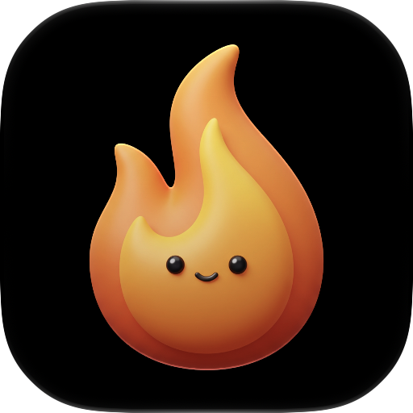

<p align="center"></p>

# Burnie

A small macOS menu bar app that shows how much of your Claude Code and Cursor plans you've used.

Click the flame icon in the menu bar to see:

- **Claude Code:** your plan, the 5-hour session and weekly limits with their reset times, and today's tokens.
- **Cursor:** your plan, the Cursor Models and Other Models pools (or included usage on team plans), on-demand spend when it's on, and today's tokens (today's spend on team and enterprise plans).
- **Last 7 days:** daily tokens for each provider.

Every bar except on-demand has a small tick where you'd be at an even pace: halfway through a 5-hour session, it sits in the middle. If you're using it faster than that, the part of the bar past the tick turns red.

Burnie reuses the sign-ins Claude Code and Cursor already have on your Mac. It never asks for a password and never writes to their files. You can turn each provider on or off from the gear button, and mark one with ♥ so a ring around the flame shows its usage without opening anything.

## Requirements

- macOS 14 Sonoma or later.
- Claude Code and/or Cursor installed and signed in on the same Mac.

## Install

1. Download `Burnie.dmg` from the [latest release](https://github.com/juanpa-a/burnie/releases/latest).
2. Open it and drag **Burnie** onto **Applications**.
3. Open Burnie from Applications. The flame icon shows up in the menu bar; Burnie has no Dock icon.

To start Burnie when you log in, click the flame, then the gear button, and turn on **Launch at login**.

### Update

Burnie checks for a new version once a day. When there is one, a blue dot shows on the gear button: click the gear, then **Update**, and Burnie installs it and relaunches.

### Uninstall

1. Open Burnie, turn off **Launch at login** if you turned it on, and choose **Quit**.
2. Delete `/Applications/Burnie.app`.
3. Optionally, delete its cache and settings:

   ```sh
   rm -rf ~/Library/Application\ Support/Burnie
   defaults delete dev.juanpa.burnie
   ```

## Build from source

Needs Xcode 26 or later, opened once so it finishes setting up (the Command Line Tools alone aren't enough), and [XcodeGen](https://github.com/yonaskolb/XcodeGen): `brew install xcodegen`.

```sh
git clone https://github.com/juanpa-a/burnie.git
cd burnie
make install
```

`make install` builds a release copy, signs it for this Mac only (no Apple developer account needed), copies it to `/Applications/Burnie.app`, and opens it. To install it somewhere else, pass a folder: `make install APPS_DIR=~/Applications`. To update it, run `git pull` and `make install` again.

To see the install window that `Burnie.dmg` opens to, run `make dmg`.

### With an agent

Paste this prompt into Claude Code, or any coding agent that can run commands on your Mac:

```text
Install the Burnie menu bar app from https://github.com/juanpa-a/burnie on this Mac.

1. Check the requirements and stop to tell me what's missing:
   - macOS 14 or later (`sw_vers -productVersion`).
   - Xcode 26 or later (`xcodebuild -version`). If only the Command Line Tools are installed, or Xcode asks to finish setting up, tell me what to do instead of trying to fix it.
   - XcodeGen (`command -v xcodegen`). If it's missing and Homebrew is installed, run `brew install xcodegen`. If Homebrew isn't installed, ask me before installing it.
2. Clone the repo into ~/Developer/burnie, or run `git pull` there if it already exists.
3. From the repo, run `make install`. If /Applications isn't writable, run `make install APPS_DIR=~/Applications` instead.
4. Confirm Burnie is running (`pgrep -x Burnie`) and tell me to click the flame icon in the menu bar.

Rules: don't use sudo. Don't read, print, or change anything in ~/.claude, ~/.config/claude, the Keychain, or Cursor's files; Burnie reads what it needs by itself. If a step fails, show me the error and stop.
```

### Update with an agent

Paste this prompt to update a Burnie you already installed:

```text
Update the Burnie menu bar app on this Mac to the latest version from https://github.com/juanpa-a/burnie.

1. Find my Burnie clone: ~/Developer/burnie if it exists. Otherwise ask me where I cloned it. Check that `git remote get-url origin` points to juanpa-a/burnie before going on.
2. In the clone, note the current commit (`git rev-parse HEAD`) and run `git pull`. If it reports local changes or a conflict, show me and stop; don't discard anything.
3. If nothing new came in, tell me Burnie is already up to date and stop.
4. Run `make install`. If Burnie.app is in ~/Applications rather than /Applications, run `make install APPS_DIR=~/Applications` instead. It quits the running Burnie and opens the new one.
5. Confirm Burnie is running (`pgrep -x Burnie`) and tell me in a few plain sentences what's new, from `git log --oneline <the commit you noted>..HEAD`.

Rules: don't use sudo. Don't read, print, or change anything in ~/.claude, ~/.config/claude, the Keychain, or Cursor's files; Burnie reads what it needs by itself. If a step fails, show me the error and stop.
```

## Privacy

- **What it reads.** Claude Code's sign-in from the Keychain (`Claude Code-credentials`) or `~/.claude/.credentials.json`, and its local logs in `~/.claude/projects` and `~/.config/claude/projects`. Cursor's sign-in from `~/Library/Application Support/Cursor/User/globalStorage/state.vscdb`.
- **Who it talks to.** `api.anthropic.com` and `cursor.com` for usage, and `github.com` once a day to check for a new Burnie. No analytics or telemetry.
- **What it writes.** Only its cache and history in `~/Library/Application Support/Burnie/`. Tokens and cookies never touch the disk or the logs.
- **What it runs.** Only when you press **Refresh sign-in** under an expired Claude sign-in: your installed `claude`, asking Haiku for a one-word reply. Claude Code then renews and saves its own sign-in; Burnie never handles the refresh token.

Burnie relies on undocumented Claude and Cursor endpoints. If one changes, Burnie shows "Couldn't read usage. Burnie may need an update." until it's updated.

## Development

| Command | What it does |
| --- | --- |
| `make run` | Builds a Debug copy and opens it. |
| `make test` | Generates the project, runs the `BurnieKit` tests, then the app's `BurnieAppTests` with `xcodebuild`. |
| `make perf` | Release-mode performance test of the log scan. |
| `make install` | Builds a Release copy and installs it, as above. |
| `make release TEAM_ID=…` | Builds a signed, notarized `Burnie.dmg` and the `appcast.xml` for updates. |

### Releasing

Once per Mac: install a Developer ID Application certificate (Xcode → Settings → Accounts → Manage Certificates), store the notarization credentials with `xcrun notarytool store-credentials burnie-notary`, and keep Sparkle's private EdDSA key in the Keychain (`generate_keys` creates it; `generate_keys -x` exports a backup and `-f` imports it on another Mac).

1. In `project.yml`, raise `MARKETING_VERSION` (0.x while Burnie is an MVP) and add one to `CURRENT_PROJECT_VERSION`. Merge that change.
2. Run `make release TEAM_ID=<your team>`.
3. Run the `gh release create` command it prints. Installed copies see the update on their next daily check.

Sparkle's tools live in `build/DerivedData/SourcePackages/artifacts/sparkle/Sparkle/bin` after any `make build`.

The rules for contributing (human or agent) live in [`AGENTS.md`](AGENTS.md).

## Credits

App icon by [Albert Hassey](https://github.com/ahasseyp).
